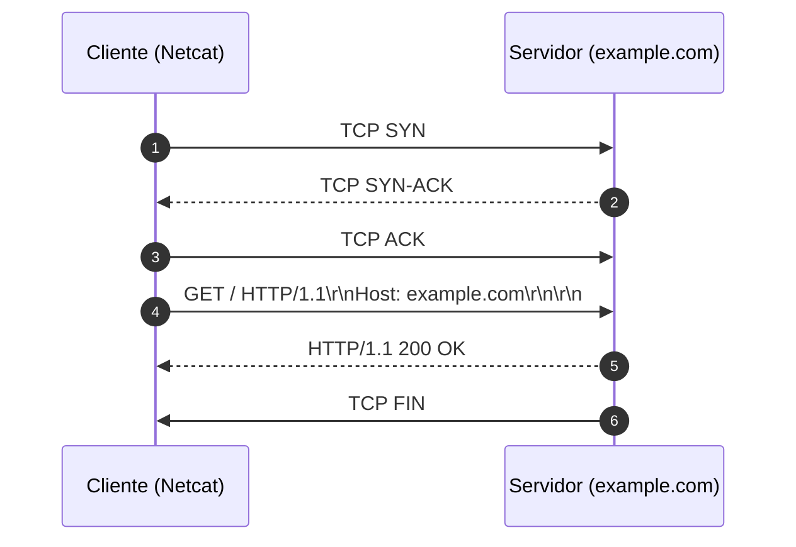

# Memória de Desenvolvimento — Semana 01
**Aluno:** Laura Maria Luiz Freitas Rangel 
**Curso:** Engenharia da Computação  

---

## 1. Mapeamento da Camada de Transporte
Diagrama Mermaid demonstrando o ciclo de vida da requisição executada no laboratório:

---

## 2. Captura Bruta e Análise do Protocolo
* **Comando Utilizado:** `nc -C example.com 80`
* **Status Line Retornada:** `HTTP/1.1 200 OK`

### Análise dos Headers Recebidos:
1. **`Content-Type`:** O "Content-Type" informa que o conteúdo retornado pelo servidor é um documento HTML codificado em UTF-8. Esse cabeçalho é importante porque permite que o navegador identifique o tipo de conteúdo recebido e utilize o parser adequado para interpretar o HTML e renderizar a página corretamente.
2. **`Content-Length`:** Esse cabeçalho serve para informar o tamanho em bytes do corpo da resposta HTTP. Esse valor permite que o cliente saiba quantos bytes deve ler para obter o conteúdo completo. No nosso caso, usamos o "Transfer - Endcoding: chuncked", que divide o corpo em blocos identificados por seus tamanhos. Isso permite delimitar o conteúdo recebido pela conexão TCP sem depender de um Content-Length fixo.
3. **`Connection: close`:** O "Connection: close" indica que a conexão TCP deve ser encerrada após a conclusão da resposta HTTP. Nesse caso, o socket é fechado ao final da comunicação, exigindo uma nova conexão para futuras requisições. Já o "Connection: keep-alive", mantem aberta para permitir múltiplas requisições e respostas, reduzindo o custo de estabelecer novas conexões TCP. No entanto, o servidor ainda pode encerrar a conexão por outros motivos.

---

## 3. Conclusão Técnica
Diferentemente de um arquivo estático local, os dados HTTP são transmitidos por uma conexão TCP, na qual o cliente envia requisições e o servidor retorna respostas compostas por cabeçalhos e corpo da mensagem. Essa compreensão permite identificar como as mensagens são estruturadas, como seus limites são determinados e como parâmetros como Content-Type, Content-Length e Connection influenciam a interpretação dos dados e o gerenciamento da conexão.
